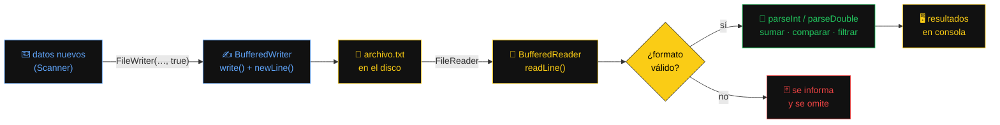
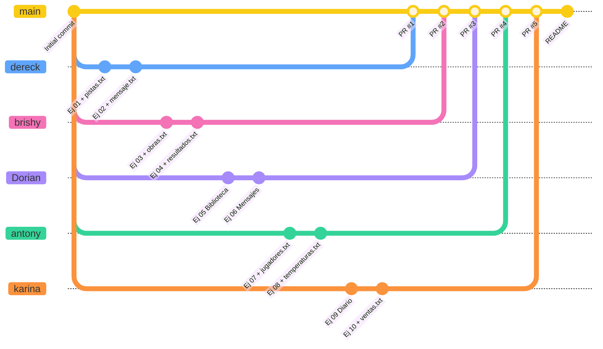

<a name="inicio"></a>

<div align="center">


<p>


</p>
<p>


</p>


**En Gotham, lo que no se guarda en disco, no existe.**

[🦇 Caso](#-el-caso) ·
[📡 Batseñal](#-transmisión-de-la-batseñal) ·
[🦸 Batfamilia](#-la-batfamilia) ·
[🌿 Ramas](#-el-protocolo-de-la-baticueva--ramas-y-pull-requests) ·
[🤵 Bitácora](#-bitácora-de-alfred) ·
[🗺️ Mapa](#️-mapa-de-gotham) ·
[📁 Expedientes](#-distrito-1--lectura-de-archivos) ·
[🧰 Batcinturón](#-batcinturón--clases-y-métodos) ·
[⚙️ Ejecución](#️-activar-la-batcomputadora) ·
[🃏 Villanos](#-galería-de-villanos)

</div>


## 🦇 El caso

> *«Un programa que olvida todo al cerrarse no le sirve a nadie en Gotham.»*

En la **APE 5 – Creación, Lectura y Escritura de Ficheros** aprendimos a que los datos sobrevivan a la ejecución. Con el paquete `java.io` cada programa **lee** pistas desde un archivo, las **procesa** (convierte texto a números, valida, busca y filtra) y **escribe** nuevos registros sin borrar los anteriores.

La guía tenía dos partes: la **primera** (ejercicios 1 a 4) se centra en **leer**, y la **segunda** (ejercicios 5 a 10) en **escribir y procesar**. Los 10 casos se repartieron entre los 5 detectives, dos por cabeza, y cada uno trabajó en **su propia rama**.




## 📡 Transmisión de la Batseñal

> **📻 Comisionado Gordon → Baticueva**
>
> *«Diez casos llegaron a la comisaría esta noche y todos dejan rastro en archivos de texto: pistas de un robo, un mensaje de emergencia, registros de un museo, puntajes, ventas… Necesito que alguien los lea, los ordene y no pierda ni una línea. La ciudad confía en ustedes.»*
>
> — *Transmisión recibida. La Batfamilia toma el caso.* 🦇


## 🦸 La Batfamilia

| | Detective | Alter ego en Gotham | Rama | GitHub | Casos | Lo que resolvió |
| :---: | :--- | :--- | :---: | :---: | :---: | :--- |
| 🔍 | **Paredes Acosta Dereck Shair** | 🐦 **Robin** · el detective de las pistas | `dereck` | [@dereckflux](https://github.com/dereckflux) | 01 · 02 | Lectura línea por línea con `readLine()` y lectura carácter por carácter con `read()` |
| 🏛️ | **Ashanga Yumbo Brishy Anahy** | 🦇 **Batgirl** · curadora del Museo de Gotham | `brishy` | [@brishy769-coder](https://github.com/brishy769-coder) | 03 · 04 | Clasificación por categorías con `split()` y cálculo de total y máximo |
| ⚔️ | **Calderón Carvajal Fher Dorian** | 🌃 **Nightwing** · caballero del backend | `Dorian` | [@Doros-ia](https://github.com/Doros-ia) | 05 · 06 | Menús con escritura en modo *append*, búsqueda de libros y mensajes cifrados |
| 🛡️ | **Casillas Ochoa Antony Sebastián** | 🛡️ **Red Hood** · guardián de la validación | `antony` | [@antonycasillas777-cloud](https://github.com/antonycasillas777-cloud) | 07 · 08 | Validación de registros, promedios, filtros y control de `NumberFormatException` |
| 📜 | **Sánchez Bastidas Karina Paola** | 📡 **Oráculo** · guardiana del repositorio | `karina` | [@Karina-com](https://github.com/Karina-com) | 09 · 10 | Diario con validación de archivo vacío, reporte de ventas y filtro por precio. Creó el repositorio y unió las ramas |

<div align="center">


| Detective | Líneas de Java | Archivos |
| :--- | :---: | :---: |
| 🔍 Dereck | 105 | 2 `.java` + 2 `.txt` |
| 🏛️ Brishy | 153 | 2 `.java` + 2 `.txt` |
| ⚔️ Dorian | 240 | 2 `.java` |
| 🛡️ Antony | 208 | 2 `.java` + 2 `.txt` |
| 📜 Karina | 275 | 2 `.java` + 1 `.txt` |
| **🦇 Total** | **981** | **10 `.java` + 7 `.txt`** |

</div>

> [!IMPORTANT]
> **Regla de la Baticueva:** ningún caso se cierra solo porque «en mi computadora sí funciona». Los 10 programas se compilaron y ejecutaron, y las salidas de abajo son las reales.


## 🌿 El protocolo de la Baticueva · Ramas y Pull Requests

Para la demostración colaborativa nadie tocó directamente `main`. Cada detective abrió **su propia rama**, subió ahí su carpeta y pidió entrar a la rama principal con un **Pull Request**.



| PR | Rama | Detective | Casos | Estado |
| :---: | :---: | :--- | :--- | :---: |
| [#1](https://github.com/Karina-com/APE5_Algoritmos_Programacion/pull/1) | `dereck` | Dereck | 01 Agencia de detectives · 02 Estación espacial | 🟣 Merged |
| [#2](https://github.com/Karina-com/APE5_Algoritmos_Programacion/pull/2) | `brishy` | Brishy | 03 Museo digital · 04 Parque de aventuras | 🟣 Merged |
| [#3](https://github.com/Karina-com/APE5_Algoritmos_Programacion/pull/3) | `Dorian` | Dorian | 05 Biblioteca inteligente · 06 Mensajes secretos | 🟣 Merged |
| [#4](https://github.com/Karina-com/APE5_Algoritmos_Programacion/pull/4) | `antony` | Antony | 07 Competencia de videojuegos · 08 Control de temperatura | 🟣 Merged |
| [#5](https://github.com/Karina-com/APE5_Algoritmos_Programacion/pull/5) | `karina` | Karina | 09 Diario de exploradores · 10 Ventas de cafetería | 🟣 Merged |

<details>
<summary><b>🦇 Cómo subió cada detective su parte (paso a paso)</b></summary>
<br>

1. Crear la rama a partir de `main` (botón **main → View all branches → New branch**).
2. Con **su rama seleccionada**, ir a **Add file → Create new file** y escribir la ruta, por ejemplo `dorian/Ejercicio05_BibliotecaInteligente/BibliotecaInteligente.java`. Las barras `/` crean las carpetas.
3. Pegar el código y hacer **Commit directly to the branch**, un commit por archivo.
4. Abrir el **Pull Request** de su rama hacia `main`.
5. **Merge pull request → Confirm merge**. La rama **no se borra**, queda como evidencia.

Con comandos sería lo mismo:

```bash
git checkout -b dorian
git add dorian/
git commit -m "Ejercicios 5 y 6 - Dorian"
git push -u origin dorian
```

</details>


## 🤵 Bitácora de Alfred

| Hora en Gotham | Registro |
| :---: | :--- |
| 🌆 Anochecer | 📡 **Oráculo** (Karina) abre la Baticueva: crea el repositorio y agrega a la Batfamilia como colaboradores. |
| 🌃 Primera ronda | Cada detective enciende su propia rama: `dereck`, `brishy`, `Dorian`, `antony` y `karina`. |
| 🌙 Medianoche | Se suben los 10 casos: un commit por archivo, cada uno firmado por su detective. |
| 🦇 Patrullaje | Cada rama pide entrar a `main` con su Pull Request: #1, #2, #3, #4 y #5. |
| 🌅 Amanecer | **Oráculo** une los 5 PR sin un solo conflicto. **Nightwing** (Dorian) deja este expediente y el banner de Gotham. |

> *«Señor, las ramas no se borraron. Quedan como evidencia, por si el comisionado pregunta quién hizo qué.»* — Alfred


## 🗺️ Mapa de Gotham

<table>
<tr>
<td valign="top" width="50%">

**🌃 Distrito 1 · Lectura de archivos** *(primera parte)*

| # | Caso | Detective |
| :---: | :--- | :---: |
| 01 | 🕵️ Agencia de detectives | 🔍 Dereck |
| 02 | 🚀 Estación espacial | 🔍 Dereck |
| 03 | 🏛️ Museo digital | 🏛️ Brishy |
| 04 | 🎢 Parque de aventuras | 🏛️ Brishy |

</td>
<td valign="top" width="50%">

**🏙️ Distrito 2 · Escritura y procesamiento** *(segunda parte)*

| # | Caso | Detective |
| :---: | :--- | :---: |
| 05 | 📚 Biblioteca inteligente | ⚔️ Dorian |
| 06 | 🔐 Mensajes secretos | ⚔️ Dorian |
| 07 | 🎮 Competencia de videojuegos | 🛡️ Antony |
| 08 | 🌡️ Control de temperatura | 🛡️ Antony |
| 09 | 🧭 Diario de exploradores | 📜 Karina |
| 10 | ☕ Ventas de una cafetería | 📜 Karina |

</td>
</tr>
</table>

```text
APE5_Algoritmos_Programacion/
├── dereck/
│   ├── Ejercicio01_AgenciaDetectives/      AgenciaDetectives.java · pistas.txt
│   └── Ejercicio02_EstacionEspacial/       EstacionEspacial.java · mensaje.txt
├── brishy/
│   ├── Ejercicio03_MuseoDigital/           MuseoDigital.java · obras.txt
│   └── Ejercicio04_ParqueAventuras/        ParqueAventuras.java · resultados.txt
├── dorian/
│   ├── Ejercicio05_BibliotecaInteligente/  BibliotecaInteligente.java
│   └── Ejercicio06_MensajesSecretos/       MensajesSecretos.java
├── antoni/
│   ├── Ejercicio07_CompetenciaVideojuegos/ CompetenciaVideojuegos.java · jugadores.txt
│   └── Ejercicio08_ControlTemperatura/     ControlTemperatura.java · temperaturas.txt
├── karina/
│   ├── Ejercicio09_DiarioExploradores/     DiarioExploradores.java
│   └── Ejercicio10_VentasCafeteria/        VentasCafeteria.java · ventas.txt
└── README.md
```

<div align="center">

</div>

## 🌃 Distrito 1 · Lectura de archivos

### 🕵️ Caso 01 · Agencia de detectives: análisis de pistas

| 🔎 Pista | 📂 Detalle |
| :--- | :--- |
| **Archivo** | [`AgenciaDetectives.java`](./dereck/Ejercicio01_AgenciaDetectives/AgenciaDetectives.java) · [`pistas.txt`](./dereck/Ejercicio01_AgenciaDetectives/pistas.txt) |
| **Detective** | 🔍 Dereck · rama `dereck` |
| **Gadgets** | `File.exists()`, `BufferedReader`, `readLine()`, contador, *try-with-resources* |
| **Misión** | Leer todas las pistas línea por línea, mostrarlas y contarlas. |

<details>
<summary><b>🖥️ Ver salida en la Batcomputadora</b></summary>

```text
=== AGENCIA DE DETECTIVES: ANALISIS DE PISTAS ===
Pista 1: Huella de zapato talla 42 junto a la ventana
Pista 2: Vaso con labial rojo en la mesa del comedor
Pista 3: Puerta trasera forzada desde afuera
Pista 4: Recibo de taxi con fecha del martes a las 23:10
Pista 5: Cabello rubio en el abrigo de la victima
Pista 6: Llamada perdida de un numero desconocido
--------------------------------------------
Total de pistas encontradas: 6
```

</details>

---

### 🚀 Caso 02 · Estación espacial: descifrado de mensajes

| 🔎 Pista | 📂 Detalle |
| :--- | :--- |
| **Archivo** | [`EstacionEspacial.java`](./dereck/Ejercicio02_EstacionEspacial/EstacionEspacial.java) · [`mensaje.txt`](./dereck/Ejercicio02_EstacionEspacial/mensaje.txt) |
| **Detective** | 🔍 Dereck · rama `dereck` |
| **Gadgets** | `FileReader`, `read()` (devuelve `-1` al final), *cast* `(char)` |
| **Misión** | Leer el mensaje carácter por carácter y contar cuántos caracteres tiene. |

<details>
<summary><b>🖥️ Ver salida en la Batcomputadora</b></summary>

```text
=== ESTACION ESPACIAL: DESCIFRADO DE MENSAJES ===
Mensaje recibido:
--------------------------------------------
ALERTA: falla en el modulo de oxigeno.
Tripulacion evacuar al sector B.
Enviar ayuda a la orbita 3.

--------------------------------------------
Total de caracteres leidos: 100
```

</details>

---

### 🏛️ Caso 03 · Museo digital: registro de obras

| 🔎 Pista | 📂 Detalle |
| :--- | :--- |
| **Archivo** | [`MuseoDigital.java`](./brishy/Ejercicio03_MuseoDigital/MuseoDigital.java) · [`obras.txt`](./brishy/Ejercicio03_MuseoDigital/obras.txt) |
| **Detective** | 🏛️ Brishy · rama `brishy` |
| **Gadgets** | `split(",")`, arreglos paralelos, `equalsIgnoreCase()` |
| **Misión** | Mostrar las obras y clasificar cuántas hay de cada categoría. |

<details>
<summary><b>🖥️ Ver salida en la Batcomputadora</b></summary>

```text
=== MUSEO DIGITAL: REGISTRO DE OBRAS ===
1. La noche estrellada  ->  Pintura
2. El pensador  ->  Escultura
3. La Gioconda  ->  Pintura
4. Guernica  ->  Pintura
5. David  ->  Escultura
6. El grito  ->  Pintura
7. Tierra de nadie  ->  Fotografia
8. Venus de Milo  ->  Escultura
9. Retrato en Quito  ->  Fotografia
--------------------------------------------
Obras por categoria:
  Pintura: 4
  Escultura: 3
  Fotografia: 2
--------------------------------------------
Total de obras registradas: 9
```

</details>

---

### 🎢 Caso 04 · Parque de aventuras: resultados de participantes

| 🔎 Pista | 📂 Detalle |
| :--- | :--- |
| **Archivo** | [`ParqueAventuras.java`](./brishy/Ejercicio04_ParqueAventuras/ParqueAventuras.java) · [`resultados.txt`](./brishy/Ejercicio04_ParqueAventuras/resultados.txt) |
| **Detective** | 🏛️ Brishy · rama `brishy` |
| **Gadgets** | `BufferedReader`, `Integer.parseInt()`, acumulador, máximo |
| **Misión** | Mostrar participantes, calcular el puntaje total e identificar el más alto. |

<details>
<summary><b>🖥️ Ver salida en la Batcomputadora</b></summary>

```text
=== PARQUE DE AVENTURAS: RESULTADOS ===
1. Mateo - 85 pts
2. Camila - 92 pts
3. Joaquin - 78 pts
  Puntaje invalido para Valeria
4. Sofia - 64 pts
5. Daniel - 88 pts
--------------------------------------------
Participantes: 5
Puntaje total: 407
Puntaje mas alto: 92 (Camila)
```

</details>

> [!TIP]
> En `resultados.txt` se dejó a propósito a *Valeria,abc* para comprobar que un puntaje mal escrito no tumba el programa.

<div align="center">

</div>

## 🏙️ Distrito 2 · Escritura y procesamiento

### 📚 Caso 05 · Biblioteca inteligente

| 🔎 Pista | 📂 Detalle |
| :--- | :--- |
| **Archivo** | [`BibliotecaInteligente.java`](./dorian/Ejercicio05_BibliotecaInteligente/BibliotecaInteligente.java) → crea `libros.txt` |
| **Detective** | ⚔️ Dorian · rama `Dorian` |
| **Gadgets** | Menú `do-while` + `switch`, `FileWriter(ARCHIVO, true)`, `contains()`, `exists()` |
| **Misión** | Registrar libros sin borrar los anteriores, listar títulos, buscar y contar. |

<details>
<summary><b>🖥️ Ver salida en la Batcomputadora</b> <i>(fragmento)</i></summary>

```text
Elija una opcion: 2
Todavia no hay libros: el archivo libros.txt no existe

Elija una opcion: 1
Titulo: Huasipungo
Autor: Jorge Icaza
Libro guardado correctamente

Elija una opcion: 2
Titulos almacenados:
  1. Cien anios de soledad (Gabriel Garcia Marquez)
  2. Huasipungo (Jorge Icaza)
  3. El principito (Antoine de Saint-Exupery)

Elija una opcion: 3
Titulo a buscar: huasi
Encontrado: Huasipungo,Jorge Icaza

Elija una opcion: 3
Titulo a buscar: Harry Potter
No existe ningun libro con ese titulo

Elija una opcion: 4
Libros registrados: 3
```

</details>

---

### 🔐 Caso 06 · Sistema de mensajes secretos

| 🔎 Pista | 📂 Detalle |
| :--- | :--- |
| **Archivo** | [`MensajesSecretos.java`](./dorian/Ejercicio06_MensajesSecretos/MensajesSecretos.java) → crea `secreto.txt` |
| **Detective** | ⚔️ Dorian · rama `Dorian` |
| **Gadgets** | `FileWriter` + `BufferedWriter`, `FileReader` + `BufferedReader`, `IOException` |
| **Misión** | Escribir (sobrescribiendo o agregando), leer, contar líneas y controlar errores. |

<details>
<summary><b>🖥️ Ver salida en la Batcomputadora</b> <i>(fragmento)</i></summary>

```text
Opcion: 1
Escriba el mensaje: El codigo es 7-4-1
Archivo sobrescrito con el nuevo mensaje

Opcion: 2
Escriba el mensaje: Reunion en el laboratorio a las 22h
Mensaje agregado al final del archivo

Opcion: 2
Escriba el mensaje: No confiar en el agente X
Mensaje agregado al final del archivo

Opcion: 3
--- Contenido de secreto.txt ---
1) El codigo es 7-4-1
2) Reunion en el laboratorio a las 22h
3) No confiar en el agente X

Opcion: 4
Lineas registradas: 3
```

</details>

> [!NOTE]
> Un solo método, `escribirMensaje(boolean agregar)`, hace las dos cosas: el `boolean` se pasa directo al constructor `new FileWriter(ARCHIVO, agregar)`.

---

### 🎮 Caso 07 · Competencia de videojuegos

| 🔎 Pista | 📂 Detalle |
| :--- | :--- |
| **Archivo** | [`CompetenciaVideojuegos.java`](./antoni/Ejercicio07_CompetenciaVideojuegos/CompetenciaVideojuegos.java) · [`jugadores.txt`](./antoni/Ejercicio07_CompetenciaVideojuegos/jugadores.txt) |
| **Detective** | 🛡️ Antony · rama `antony` |
| **Gadgets** | `registroValido()`, `parseInt()`, rango 0–100, promedio, filtro `> 70` |
| **Misión** | Validar registros, calcular promedio, hallar al mejor y filtrar a los que superan 70. |

<details>
<summary><b>🖥️ Ver salida en la Batcomputadora</b></summary>

```text
=== COMPETENCIA DE VIDEOJUEGOS ===
  ShadowFox -> 88
  PixelQueen -> 72
  Nova -> 65
  [Linea 4] la puntuacion no es numero: "noventa"
  Lobo23 -> 95
  [Linea 6] formato incorrecto: "SinPuntaje"
  Kira -> 70
  [Linea 8] puntaje fuera de rango: 120
  Zeta -> 81
--------------------------------------------
Jugadores validos: 6
Promedio de puntuacion: 78.50
Mejor jugador: Lobo23 con 95 puntos
Jugadores con mas de 70 puntos:
  * ShadowFox (88)
  * PixelQueen (72)
  * Lobo23 (95)
  * Zeta (81)
```

</details>

> [!TIP]
> Los tres registros malos (*noventa*, *SinPuntaje* y *120*) son intencionales: cada uno prueba una validación distinta.

---

### 🌡️ Caso 08 · Control de temperatura

| 🔎 Pista | 📂 Detalle |
| :--- | :--- |
| **Archivo** | [`ControlTemperatura.java`](./antoni/Ejercicio08_ControlTemperatura/ControlTemperatura.java) · [`temperaturas.txt`](./antoni/Ejercicio08_ControlTemperatura/temperaturas.txt) |
| **Detective** | 🛡️ Antony · rama `antony` |
| **Gadgets** | `Double.parseDouble()`, `NumberFormatException`, acepta coma o punto decimal |
| **Misión** | Guardar temperaturas, calcular promedio y máxima, y contar las que pasan de 30 °C. |

<details>
<summary><b>🖥️ Ver salida en la Batcomputadora</b> <i>(fragmento)</i></summary>

```text
Opcion: 1
Temperatura en grados C: 35,1
Temperatura guardada

Opcion: 1
Temperatura en grados C: calor
Eso no es una temperatura valida: calor

Opcion: 2
Registros:
  Dia 1: 24.5 C
  Dia 2: 28.0 C
  Dia 3: 31.2 C
  Dia 4: dato invalido "error" (se omite)
  Dia 5: 33.8 C
  Dia 6: 29.4 C
  Dia 7: 35.1 C
--------------------------------------------
Promedio: 30.33 C
Temperatura mas alta: 35.1 C
Registros mayores a 30.0 C: 3
```

</details>

---

### 🧭 Caso 09 · Diario de exploradores

| 🔎 Pista | 📂 Detalle |
| :--- | :--- |
| **Archivo** | [`DiarioExploradores.java`](./karina/Ejercicio09_DiarioExploradores/DiarioExploradores.java) → crea `descubrimientos.txt` |
| **Detective** | 📜 Karina · rama `karina` |
| **Gadgets** | `exists()` + `length() == 0`, `split(",", 2)`, `equalsIgnoreCase()` |
| **Misión** | Escribir y agregar descubrimientos, leerlos, contarlos y buscar uno por nombre. |

<details>
<summary><b>🖥️ Ver salida en la Batcomputadora</b> <i>(fragmento)</i></summary>

```text
Opcion: 2
El diario no existe todavia

Opcion: 1
Nombre del descubrimiento: Orquidea azul
Descripcion corta: Flor rara, cerca del rio
Descubrimiento anotado en el diario

Opcion: 2
1. Cascada escondida -> Caida de agua de 40 m en el valle norte
2. Cueva de cristales -> Paredes cubiertas de cuarzo
3. Orquidea azul -> Flor rara, cerca del rio

Opcion: 3
Nombre a buscar: cueva de cristales
Encontrado: Cueva de cristales,Paredes cubiertas de cuarzo

Opcion: 4
Descubrimientos: 3
```

</details>

> [!NOTE]
> `split(",", 2)` corta solo en la **primera** coma: así *«Flor rara, cerca del rio»* no se parte en dos.

---

### ☕ Caso 10 · Sistema de ventas de una cafetería

| 🔎 Pista | 📂 Detalle |
| :--- | :--- |
| **Archivo** | [`VentasCafeteria.java`](./karina/Ejercicio10_VentasCafeteria/VentasCafeteria.java) · [`ventas.txt`](./karina/Ejercicio10_VentasCafeteria/ventas.txt) |
| **Detective** | 📜 Karina · rama `karina` |
| **Gadgets** | `BufferedWriter`, `convertirPrecio()`, `printf`, filtro por valor |
| **Misión** | Registrar ventas, calcular el total, hallar el producto más caro y filtrar por precio. |

<details>
<summary><b>🖥️ Ver salida en la Batcomputadora</b> <i>(fragmento)</i></summary>

```text
Opcion: 1
Producto: Galleta
Precio: $-1
Datos invalidos, la venta no se registro

Opcion: 2
  Capuchino            $  2.50
  Espresso             $  1.75
  Sanduche de pollo    $  4.25
  Torta de chocolate   $  3.00
  Precio incorrecto en: Jugo de mora,dos
  Chocolate caliente   $  2.00
  Mocaccino            $  3.10
--------------------------------------------
Total de ventas: $16.60
Producto de mayor precio: Sanduche de pollo ($4.25)

Opcion: 3
Mostrar productos con precio mayor a: $2.5
  Sanduche de pollo - $4.25
  Torta de chocolate - $3.00
  Mocaccino - $3.10
Productos encontrados: 3
```

</details>


## 🧰 Batcinturón · Clases y métodos

| Gadget | Qué hace | Casos |
| :--- | :--- | :---: |
| 📁 `File` + `exists()` | Revisa si el archivo está en el disco antes de abrirlo | 01–10 |
| 📏 `length()` | Tamaño en bytes; `0` significa archivo vacío | 09 |
| 🔤 `FileReader` + `read()` | Lee un carácter a la vez; devuelve `-1` al final | 02 |
| 📖 `BufferedReader` + `readLine()` | Lee una línea completa; devuelve `null` al final | 01, 03–10 |
| ✍️ `FileWriter(nombre, true)` | Escribe **al final** sin borrar lo anterior | 05, 06, 08, 09, 10 |
| 💥 `FileWriter(nombre, false)` | **Sobrescribe** todo el archivo | 06 |
| 📚 `BufferedWriter` + `newLine()` | Escribe línea por línea con el salto correcto | 05, 06, 08, 09, 10 |
| ✂️ `split(",")` | Separa una línea en partes | 03, 04, 05, 07, 09, 10 |
| 🔢 `Integer.parseInt()` / `Double.parseDouble()` | Convierte texto a número | 04, 07, 08, 10 |
| 🧯 `try-with-resources` | Cierra el archivo solo, aunque haya error | 01–10 |
| 🃏 `IOException` / `NumberFormatException` | Atrapan errores de archivo y de conversión | 01–10 |


## ⚙️ Activar la Batcomputadora

```bash
git clone https://github.com/Karina-com/APE5_Algoritmos_Programacion.git
cd APE5_Algoritmos_Programacion/antoni/Ejercicio07_CompetenciaVideojuegos
javac -encoding UTF-8 CompetenciaVideojuegos.java
java CompetenciaVideojuegos
```

> [!WARNING]
> Cada programa busca su `.txt` en la carpeta **desde donde se ejecuta**. En NetBeans el `.txt` va en la raíz del proyecto, al lado de `src`, no dentro.

> [!NOTE]
> Los casos **05**, **06** y **09** no traen `.txt`: el programa lo crea al registrar el primer dato.


## 🃏 Galería de villanos

| Villano | Su crimen con ficheros | Cómo lo detuvimos | Caso |
| :--- | :--- | :--- | :---: |
| 🃏 **El Joker** | `FileNotFoundException` porque el archivo no existe | `if (!f.exists())` antes de leer | 01–10 |
| 🪙 **Dos Caras** | `new FileWriter(archivo)` sin `true` borra todo el pasado | Modo *append*: `FileWriter(archivo, true)` | 05, 09 |
| 🧊 **Mr. Freeze** | Olvidar `close()` y el archivo queda congelado y vacío | *try-with-resources* | 01–10 |
| ❓ **El Acertijo** | `"noventa"` donde debía ir un número | `try { parseInt } catch (NumberFormatException)` | 04, 07, 08 |
| 🐧 **El Pingüino** | Líneas sin coma o con campos de más | `if (partes.length != 2)` | 03, 07, 10 |
| 💪 **Bane** | Puntajes de 120 o precios negativos | Validar el rango antes de usarlo | 07, 10 |
| 😱 **El Espantapájaros** | El archivo existe pero está vacío | `f.length() == 0` | 09 |
| 🌿 **Hiedra Venenosa** | Una descripción con comas se parte en dos | `split(",", 2)` | 09 |
| 🪟 **Clayface** | El `\r` de Windows se cuela en el conteo | Ignorar `'\r'` al leer con `read()` | 02 |

<details>
<summary><b>🤵 Alfred y el modo append</b></summary>
<br>

—Alfred, registré un libro nuevo y desaparecieron los otros dos.

—Señor, abrió el `FileWriter` sin el `true`. Dos Caras lanzó la moneda y salió *sobrescribir*.

**Desde entonces, todos los registros de la Baticueva se abren en modo append.**

</details>

<details>
<summary><b>🦇 Batman y el readLine()</b></summary>
<br>

—¿Cuándo dejo de leer, Alfred?

—Cuando `readLine()` le devuelva `null`, señor. Ni una línea antes, ni una después.

</details>

<details>
<summary><b>❓ El acertijo final</b></summary>
<br>

*«Te devuelvo un número aunque leas letras, y cuando ya no queda nada te digo -1. ¿Quién soy?»*

**Respuesta:** el método `read()` de `FileReader`.

</details>


<div align="center">

## 🦇 MISIÓN COMPLETADA


| 🔍 Dereck | 🏛️ Brishy | ⚔️ Dorian | 🛡️ Antony | 📜 Karina |
| :---: | :---: | :---: | :---: | :---: |
| [`dereck`](https://github.com/Karina-com/APE5_Algoritmos_Programacion/tree/dereck) | [`brishy`](https://github.com/Karina-com/APE5_Algoritmos_Programacion/tree/brishy) | [`Dorian`](https://github.com/Karina-com/APE5_Algoritmos_Programacion/tree/Dorian) | [`antony`](https://github.com/Karina-com/APE5_Algoritmos_Programacion/tree/antony) | [`karina`](https://github.com/Karina-com/APE5_Algoritmos_Programacion/tree/karina) |

**Algoritmos y Lógica de Programación · Ing. José Rubén Caiza · Julio – Diciembre 2026**

*Primero lo imaginamos. Luego lo programamos. Y si falla, lo depuramos juntos.*

[⬆️ Volver a la Baticueva](#inicio)

<sub>Proyecto académico sin fines comerciales · Universidad Técnica de Ambato · Batman y sus personajes pertenecen a DC Comics.</sub>


</div>
